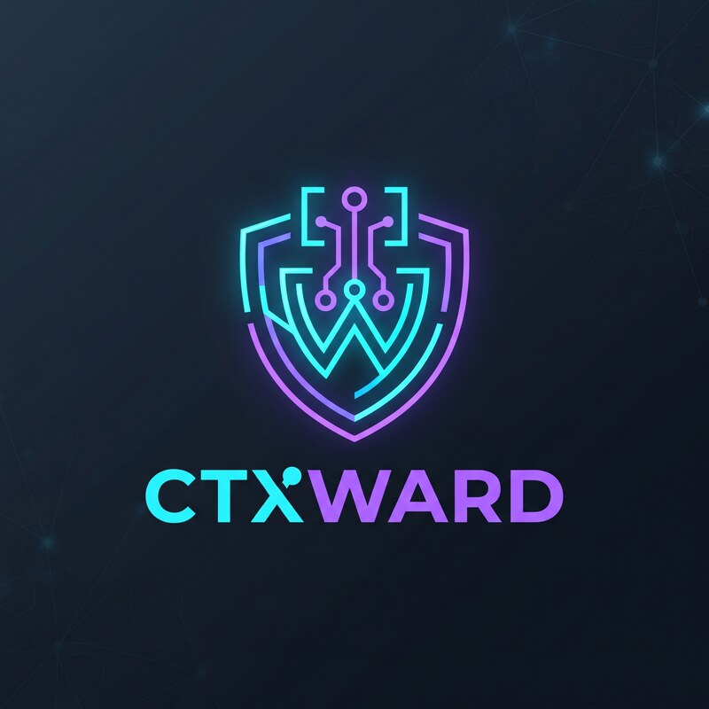

<p align="center">
  
</p>

# ctxward

[](https://github.com/SchreiverJ/ctxward/actions/workflows/ci.yml)
[](https://github.com/SchreiverJ/ctxward/releases)
[](LICENSE)

A Claude Code plugin that keeps chosen environment variables out of what the model sees: their **values**, and
optionally their **names**. It works on tool output and on your prompts.

You list variable names. ctxward reads the values from the environment Claude Code was started in, holds them in
memory, and never stores them. See [DESIGN.md](DESIGN.md).

**It is a best-effort filter for accidental exposure, not a security boundary.** See *Not covered*.

## Install

```
/plugin marketplace add SchreiverJ/ctxward
/plugin install ctxward@ctxward
```

Prebuilt binaries for Linux, macOS (Apple Silicon and Intel) and Windows are in the repository; no Go toolchain
is needed. Update with `/plugin marketplace update ctxward`, remove with `/plugin uninstall ctxward`.
To build from source instead: `make dist` (needs Go), then `claude --plugin-dir /path/to/ctxward/plugin`.

## Set up

1. Create the config file (run `ctxward check` to see the exact path):
   Linux `~/.config/ctxward/vars`, macOS `~/Library/Application Support/ctxward/vars`, Windows `%AppData%\ctxward\vars`.
   Start `claude` from a terminal where the variables are exported; apps launched from the Dock or Spotlight do not see shell-profile variables.

   ```
   GITHUB_TOKEN                 # hide the value only; the name stays visible (the default)
   STRIPE_SECRET_KEY   value    # same, written out
   DATABASE_PASSWORD   both     # hide the value and the name
   ```

2. Export those variables in the shell that starts Claude Code, then start it.
3. In Claude Code, run `! ctxward check`: counts only, including how many values are unset or too short. To see
   which variables, run `ctxward check --names` in a normal terminal. It refuses inside Claude Code, where the output
   would reach the model, and prints the full path to paste into a terminal instead. Your own terminal needs
   your variables exported, as in step 2.

## What happens

| You / the model | Result |
|---|---|
| A tool prints a value or a hidden name | the model sees `[REDACTED]` |
| You type a value or a hidden name in a prompt | the prompt is blocked, nothing is sent, the reason names nothing |
| A value is hidden while you are in auto mode | the next Bash command is not run; the session switches to manual mode so you decide what happens next |
| The model tries to save `[REDACTED]` into a file | refused (it would corrupt your code) |
| The model tries to read the config | refused (accidental reads only; a command that builds the path indirectly gets past it) |
| Config exists but is broken | output is withheld and prompts are blocked until you fix it |
| No config | nothing is protected; SessionStart says so |

Values under 8 bytes (or unset) are not searched for, because they would redact ordinary words; their count is
shown at session start. Names match as whole identifiers, so hiding `API_KEY` leaves `MY_API_KEY2` alone.
Encodings searched: raw, URL-encoded, base64.

## Not covered

`@file` mentions, CLAUDE.md, pasted text, images and PDFs, MCP results flagged as errors, the raw WebFetch page,
async subagent results, and Bash output over 30 KB (spilled raw to disk by Claude Code). A name or value in any of
these reaches the model. A model that deliberately splits or re-encodes output also gets through, as does any
secret not in your list.

## Verifying the binaries

The binaries in `plugin/libexec/` are unsigned, and installs pull them from this repository.

- `make verify` in a fresh clone rebuilds them and fails on any difference (needs the Go version pinned in the workflows).
- `gh attestation verify plugin/libexec/linux-amd64/ctxward --repo SchreiverJ/ctxward` checks a binary against the
  build attestation published with each release.

## Develop

```
make test         # go vet + go test -race
make plugin-test  # drive the hooks through the launcher (ARGS=live also runs claude -p --plugin-dir)
go test ./internal/vault -run xxx -bench .
```

## Releasing

1. Bump `version` in `plugin/.claude-plugin/plugin.json`, then `make test dist checksums` and commit the result
   (the binaries and `SHA256SUMS` are committed, and CI fails if they differ from a rebuild: `make verify`).
2. Push to `main` and wait for CI.
3. `git tag v<version> && git push origin v<version>`. The Release workflow checks the tag against `plugin.json`,
   rebuilds, publishes the binaries and `checksums.txt` with build provenance, and generates the notes.

The Go version is pinned in both workflows (`GO_VERSION`) because it is embedded in the binaries. Change it there
and in your local toolchain together, then rebuild.
